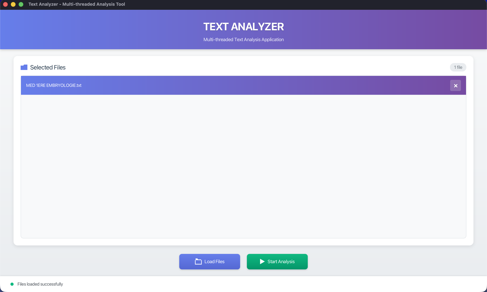

# 📊 Text Analyzer

<div align="center">


**A Modern Multi-threaded Text Analysis Desktop Application**

[Features](#-features) • [Getting Started](#-getting-started) • [Architecture](#-architecture) • [Roadmap](#-roadmap) • [Contributing](#-contributing)

</div>

---

## Overview

Text Analyzer is a JavaFX-based desktop application designed to analyze multiple text files concurrently. Built with modern Java 21 and JavaFX 21, it features a stunning dark-themed UI with glassmorphism effects and provides real-time text analysis capabilities.

### Project Goals

- Concurrent processing of multiple text files
- Real-time progress tracking for each analysis task
- Comprehensive text statistics (word count, unique words, frequency analysis)
- Robust error handling and user-friendly interface
- Modern, intuitive design with smooth animations

---

## Features

### Current (Sprint 1 - UI Skeleton) (Completed)

- ✅ **Modern UI** - Glassmorphism & Modern design with graidents colors
- ✅ **File Management** - Load multiple .txt files with native file picker
- ✅ **Visual File List** - Custom list cells with individual remove buttons
- ✅ **Status Tracking** - Real-time status updates with color-coded indicators
- ✅ **Responsive Design** - Flexible layout with minimum window constraints
- ✅ **CSS-based Icons** - Vector-based icons using SVG shapes

### Upcoming (Sprint 2 - Multithreading)

- 🚧 Concurrent file analysis using ThreadPoolManager
- 🚧 Real-time progress indicators per file
- 🚧 CompletableFuture-based async processing
- 🚧 Text statistics: total words, unique words, frequencies

### Future (Sprint 3 - Analysis Algorithms) 📋

- 📋 Advanced text analysis algorithms
- 📋 Results visualization and export
- 📋 Most frequent terms analysis
- 📋 Comprehensive error handling

---

## 🖼️ Screenshots

<div align="center">

### Main Interface



_Modern white theme with glassmorphism effects and gradient backgrounds_

### File Analysis View

_Real-time progress tracking (Coming in Sprint 2)_

</div>

---

## 🚀 Getting Started

### Prerequisites

- **Java 21** or higher ([Download](https://www.oracle.com/java/technologies/downloads/))
- **Maven 3.8+** ([Download](https://maven.apache.org/download.cgi))
- **JavaFX 21** (automatically managed by Maven)

### Installation

1. **Clone the repository**

   ```bash
   git clone https://github.com/MarwaneQ/text-analyzer.git
   cd text-analyzer
   ```

2. **Build the project**

   ```bash
   mvn clean compile
   ```

3. **Run the application**
   ```bash
   mvn javafx:run
   ```

### Alternative: Using IDE

#### IntelliJ IDEA

1. Open project folder
2. Maven dependencies auto-download
3. Run `App.java` main method

#### Eclipse

1. Import as Maven project
2. Update project (Alt+F5)
3. Run as Java Application

---

## 🏗️ Architecture

### Project Structure

```
text-analyzer/
├── src/main/java/com/textanalyzer/
│   ├── App.java                          # Application entry point
│   ├── controllers/                      # UI controllers (MVC)
│   │   ├── PrimaryController.java        # Main screen logic
│   │   └── SecondaryController.java      # Results screen logic
│   ├── services/                         # Business logic layer
│   │   ├── FileLoaderService.java        # File operations
│   │   └── TextAnalysisService.java      # Analysis algorithms
│   ├── models/                           # Data models (POJOs)
│   │   ├── AnalysisResult.java           # Analysis results data
│   │   └── AnalyzedFile.java             # File metadata
│   ├── utils/                            # Helper utilities
│   │   ├── ThreadPoolManager.java        # Thread management
│   │   └── FileUtils.java                # File utilities
│   └── exceptions/                       # Custom exceptions
│       └── InvalidFileException.java     # File validation errors
├── src/main/resources/com/textanalyzer/
│   ├── primary.fxml                      # Main UI layout
│   ├── secondary.fxml                    # Results UI layout
│   └── styles.css                        # Dark theme styling
└── pom.xml                               # Maven configuration
```

### Design Patterns

- **MVC (Model-View-Controller)** - Separation of concerns
- **Observer Pattern** - ListView change listeners for reactive UI
- **Singleton Pattern** - ThreadPoolManager for resource management
- **Factory Pattern** - Custom ListCell creation

### Technology Stack

| Component     | Technology | Version  |
| ------------- | ---------- | -------- |
| Language      | Java       | 21 (LTS) |
| UI Framework  | JavaFX     | 21       |
| Build Tool    | Maven      | 3.11.0   |
| Module System | JPMS       | Java 21  |

---

## 🎨 UI/UX Design

### Color Scheme

- **Header Gradient**: Purple to Pink (`linear-gradient(135deg, #667eea 0%, #764ba2 50%, #f093fb 100%)`)
- **Background**: Light gray (`#f5f5f5`)
- **Cards**: White (`#ffffff`) with subtle shadows
- **File Row**: Purple gradient (`#667eea → #f093fb`) with hover effects
- **Load Button**: Blue gradient (`#4a90e2 → #357abd`)
- **Start Button**: Green gradient (`#11998e → #38ef7d`)
- **Status Indicator**: Teal (`#11998e`) for success state

### Key Features

- **Gradient Header** - Bold purple-to-pink gradient with white text
- **Clean Card Design** - White glassmorphic cards with rounded corners and soft shadows
- **File List Rows** - Purple gradient backgrounds with white text and remove buttons
- **Action Buttons** - Large rounded buttons with gradient fills and icon graphics
- **Smooth Animations** - Scale effects on hover/press
- **Responsive Layout** - BorderPane with flexible regions
- **Custom Icons** - SVG-based vector icons in CSS (folder and play icons)
- **Status Bar** - Bottom indicator with color-coded messages

---

## 📚 Documentation

- **[Sprint 1 Codebase Report](SPRINT1_CODEBASE_REPORT.md)** - Comprehensive line-by-line analysis
- **[Copilot Instructions](.github/copilot-instructions.md)** - AI coding assistant guide
- **[Project Overview](ProjectOverview.txt)** - Course project requirements

---

## 🛠️ Development

### Build Commands

```bash
# Clean and compile
mvn clean compile

# Run application
mvn javafx:run

# Package application
mvn package

# Run tests (Sprint 2+)
mvn test
```

### Code Style

- **Indentation**: 4 spaces
- **Line Length**: 100 characters max
- **Naming**: camelCase for methods/variables, PascalCase for classes
- **Comments**: JavaDoc for public APIs

### Module Configuration

The project uses Java Platform Module System (JPMS):

```java
module com.textanalyzer {
    requires javafx.controls;
    requires javafx.fxml;

    opens com.textanalyzer to javafx.fxml;
    opens com.textanalyzer.controllers to javafx.fxml;

    exports com.textanalyzer;
    exports com.textanalyzer.controllers;
    // ... other packages
}
```

---

## 🗺️ Roadmap

### Sprint 1: UI Development ✅ (Completed)

- [x] JavaFX GUI design
- [x] File loading functionality
- [x] File display with custom cells
- [x] Event handlers for all interactions
- [x] Modern dark theme with glassmorphism

### Sprint 2: Multithreading 🚧 (In Progress)

- [ ] ThreadPoolManager implementation
- [ ] TextAnalysisService with concurrent processing
- [ ] Real-time progress indicators
- [ ] CompletableFuture-based async operations
- [ ] Per-file status tracking

### Sprint 3: Analysis Algorithms 📋 (Planned)

- [ ] Word counting algorithm
- [ ] Unique word detection
- [ ] Word frequency calculation
- [ ] Top N most frequent terms
- [ ] Results export functionality
- [ ] Error handling with custom exceptions

---

## 🤝 Contributing

Contributions are welcome! Please follow these steps:

1. Fork the repository
2. Create a feature branch (`git checkout -b feature/AmazingFeature`)
3. Commit your changes (`git commit -m 'Add AmazingFeature'`)
4. Push to the branch (`git push origin feature/AmazingFeature`)
5. Open a Pull Request

### Contribution Guidelines

- Follow existing code style
- Add JavaDoc comments for public methods
- Update documentation for new features
- Test thoroughly before submitting PR

---

## 📝 License

This project is licensed under the MIT License - see the [LICENSE](LICENSE) file for details.

---

## 👥 Authors

- **Marwane Eben** - _Initial work_ - [MarwaneQ](https://github.com/MarwaneQ)

### Course Information

- **Course**: Concurrency Programming (2025-2026)
- **Instructor**: Dr. Boudjellal Nada
- **Institution**: [Your University Name]

---

## 🙏 Acknowledgments

- JavaFX community for excellent documentation
- Maven Central for dependency management
- OpenJDK team for Java 21
- Course instructor for project guidance

---

## 📞 Contact & Support

- **GitHub Issues**: [Report bugs or request features](https://github.com/MarwaneQ/text-analyzer/issues)
- **Email**: [your.email@example.com]
- **Documentation**: [Wiki](https://github.com/MarwaneQ/text-analyzer/wiki)

---

<div align="center">

**Made with ❤️ using Java & JavaFX**

⭐ Star this repo if you find it helpful!

[Back to Top](#-text-analyzer)

</div>
